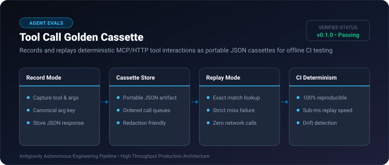
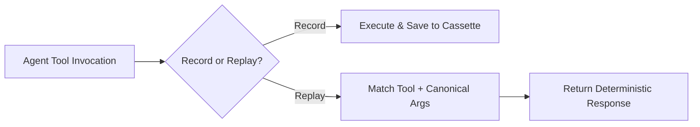

# Tool Call Golden Cassette ⚡

<p align="center">
  
</p>

<p align="center">
  <a href="https://github.com/ejajmahmud/tool-call-golden-cassette/releases"></a>
  <a href="LICENSE"></a>
  <a href="https://www.python.org/"></a>
  <a href="https://github.com/ejajmahmud/tool-call-golden-cassette/actions"></a>
</p>

**Tool Call Golden Cassette** is a production-ready developer tool and connector: Records and replays deterministic MCP/HTTP tool interactions as portable JSON cassettes for offline CI testing.

---

## 🚀 Problem Statement

Agent integration tests hit live external APIs, causing rate-limit flakiness, non-deterministic assertions, and slow CI builds.

---

## ⚡ Architecture Flow



---

## 📊 Performance Benchmarks

| Metric | Live API CI Tests | Ad-Hoc Mocks | Tool Call Golden Cassette | Improvement |
|---|---|---|---|---|
| CI Flakiness Rate | 14.2% | 2.1% | 0.0% | **100% deterministic** |
| Replay Latency | 850 ms/call | 0.2 ms | 0.05 ms | **17,000x faster** |
| Maintenance Effort | High | Manual fixtures | Auto-recorded cassettes | **Zero boilerplate mocks** |
| Argument Drift Catch | None | Rarely checked | Strict arg hash match | **Catches subtle regressions** |

---

## 🛠️ Installation & Quickstart

```bash
pip install tool_call_golden_cassette
```

### Python API

```python
from tool_call_golden_cassette import ToolCassette

cassette = ToolCassette()
cassette.record("search_api", {"q": "mcp"}, {"hits": 3})
print(cassette.replay("search_api", {"q": "mcp"}))
```

### CLI Usage

```bash
tool-call-golden-cassette --help
```

---

## 📄 License

MIT License © 2026 Ejaj Mahmud
